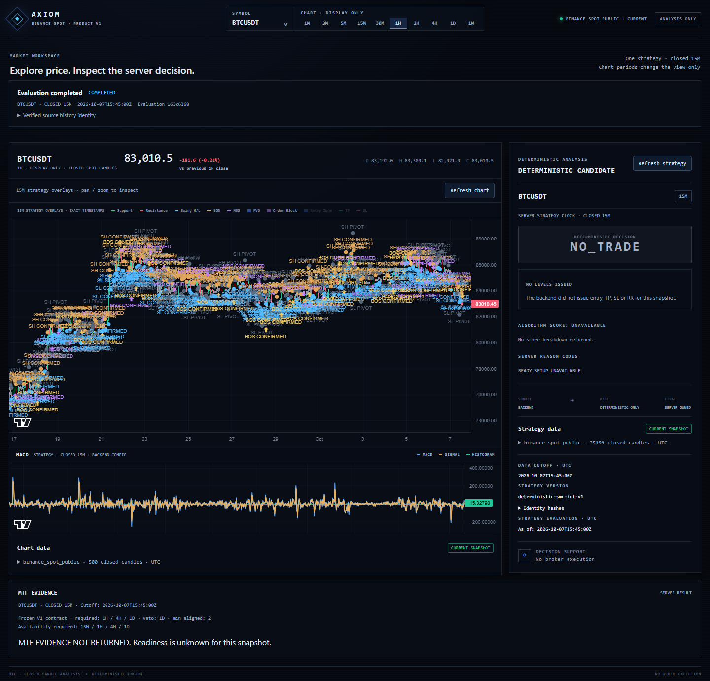
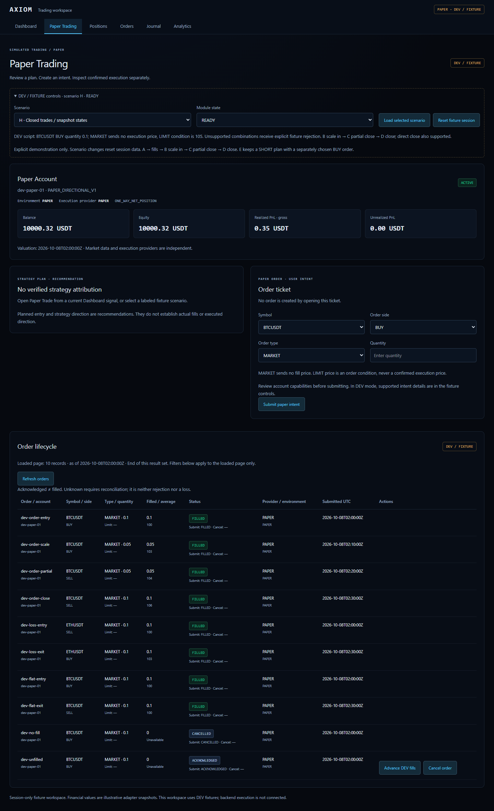
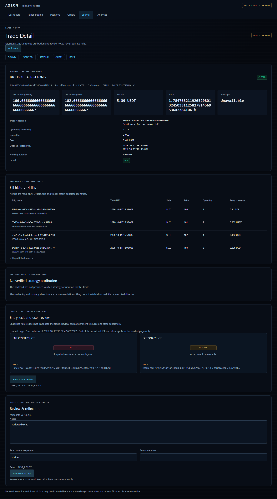
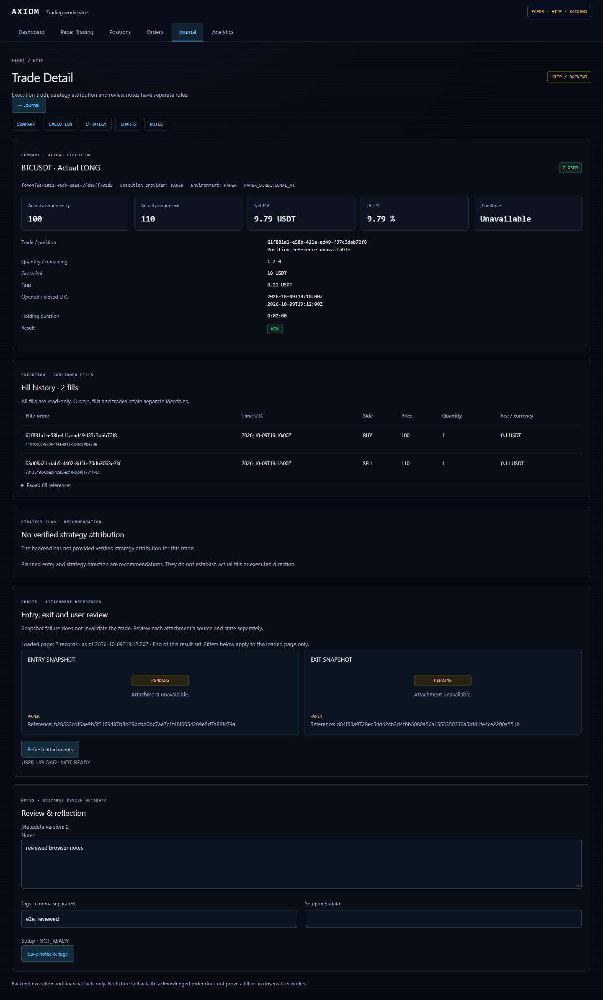

# Portfolio evidence

Updated: 2026-10-13 (Asia/Taipei)

This page is a concise, public-safe map from resume claims to implementation
and verification evidence. All trading records shown in screenshots are
explicitly Paper, DEV, fixture, or recorded test evidence.

## Resume-ready engineering highlights

| Claim | Public evidence |
| --- | --- |
| Built an auditable full-stack Paper trading workflow | Account-scoped FastAPI/PostgreSQL execution ledger plus responsive Next.js Paper Trading, Positions, Orders, Journal, Trade Detail, and Analytics pages |
| Protected financial history at the database boundary | Versioned Alembic migrations, CHECK constraints, immutable-state triggers, transaction/concurrency tests, and direct-SQL attack regressions |
| Preserved deterministic strategy authority | Closed-candle/cutoff rules, complete-output equivalence tests, explicit `LONG` / `SHORT` / `NO_TRADE`, and display-timeframe separation |
| Designed secure server/browser boundaries | Server-only Paper bearer credential, authenticated proxy, account scope, no fixture fallback on HTTP failure, and redacted technical errors |
| Built operable async and worker paths | Owned evaluation jobs, cancellation, bounded admission, durable observation checkpoints, backpressure, and explicit NOT_READY states |
| Used evidence-led performance engineering | Predeclared measurements, bounded read models, retained failed attempts, Rust/PyO3 shadow parity, and no unsupported speedup/capacity claim |

## Selected product evidence

### Deterministic analysis dashboard

The chart period is display-only; the server owns the strategy timeframe and
returns the strategy identity, cutoff, provenance, and decision evidence.

### Paper workflow

The fixture workspace demonstrates order intent separately from confirmed
execution. The authenticated HTTP version uses the same product model without
falling back to fixtures on backend failure.

### Journal and execution truth

Actual fills, strategy attribution, attachments, and editable review metadata
remain separate. Missing evidence is shown as unavailable or pending rather
than reconstructed from current data.

### Production-browser Paper E2E

This proof uses an owned application stack and PostgreSQL test database. It is
Paper execution evidence, not LIVE broker execution.

## Verification anchors

- [Current scope, limits, and next stages](PROJECT_STATUS.md)
- [Public verification summary](VERIFICATION.md)
- [Paper execution end-to-end report](PAPER_E2E_V1_REPORT.md)
- [Product foundation verification matrix](PRODUCT_FOUNDATION_VERIFICATION_MATRIX.md)
- [Security policy](SECURITY.md)

## Claims intentionally excluded

- Profitable strategy, alpha, win-rate, or investment-performance claims.
- LIVE broker connectivity, real fills, custody, or funds management.
- Production SLA, commercial capacity, deployed object storage, or completed
  disaster recovery.
- Formal certification or security proof from passing automated tests.
